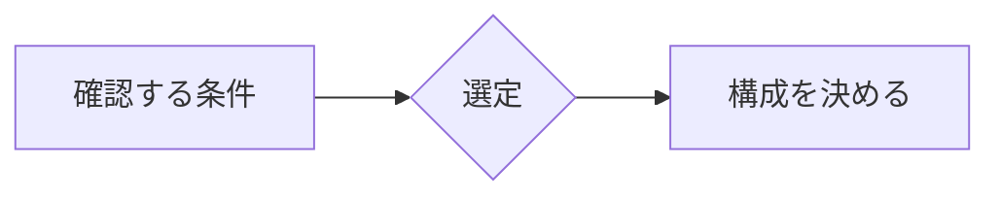

導入文を書きます。

## 見出し

- 箇条書き
- 箇条書き

## まとめ

記事の結論を書きます。

## 補足・注意ボックス(コールアウト)

<div class="callout callout-note" markdown="1">
ℹ 補足です。囲みの中にMarkdown(太字・リスト・コード)も書けます。
</div>

<div class="callout callout-tip" markdown="1">
✔ ポイント。要点やコツを強調したいときに。
</div>

<div class="callout callout-warn" markdown="1">
⚠ 注意。落とし穴や確認事項を書きます。
</div>

<div class="callout callout-summary" markdown="1">
▶ 結論。記事冒頭やまとめのチェックに。
</div>

## 会話形式(質問と回答のふきだし)

<p class="chat-bubble chat-user" markdown="span">例えばPLCのサイクルタイムは何を確認すればいい?</p>

<p class="chat-bubble chat-ai" markdown="span">通信周期と実機データの更新周期は別です。まず仕様表の通信周期欄と、実機のログを確認しましょう。</p>

## 折りたたみ

<details class="fold" markdown="1">
<summary markdown="span">詳細な設定値はここをクリック</summary>

クリックで開く本文を書きます。Markdownが使えます。

- 詳細項目1
- 詳細項目2
</details>

## チェックリスト

- [ ] 項目1
- [x] 完了した項目

## 図解(必要な場合)



## 設定例(必要な場合)

```text
通信周期: 4 ms
局番: 1
```

