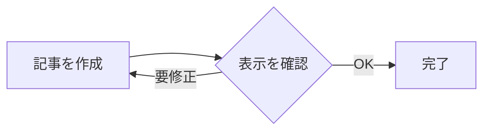

この記事は、最近追加した記事フォーマットが本番サイトで正しく表示されるか確認するためのテストです。内容はサンプルで、機器の選定や設定を案内するものではありません。

## 表示確認

通常の本文、**太字**、`コード表記`、リンクを確認します。[トップページへ](/fa_genba.github.io/)

| 項目 | サンプル | 確認 |
| --- | --- | --- |
| 表 | テスト用の値 | 表示 |
| 箇条書き | ・項目A<br>・項目B | 表示 |

## 囲み

<div class="callout callout-summary" markdown="1">
この記事は表示確認用です。ここは結論ボックスのテストです。
</div>

<div class="callout callout-note" markdown="1">
補足ボックスのテストです。**太字**と`コード`も表示されます。
</div>

<div class="callout callout-tip" markdown="1">
ポイントボックスのテストです。
</div>

<div class="callout callout-warn" markdown="1">
注意ボックスのテストです。ここに実際の機器設定は書いていません。
</div>

<div class="callout callout-danger" markdown="1">
重要ボックスの表示テストです。
</div>

## 会話

<p class="chat-bubble chat-user" markdown="span">これは質問側のふきだしテストです。</p>

<p class="chat-bubble chat-ai" markdown="span">こちらは回答側のふきだしテストです。</p>

## チェックリスト

- [x] 完了項目の表示
- [ ] 未完了項目の表示

## 折りたたみ

<details class="fold" markdown="1">
<summary markdown="span">クリックして詳細を確認</summary>

開いたときの本文です。**Markdownの書式**も使えます。

- 詳細項目A
- 詳細項目B
</details>

## Mermaid図



## コードブロック

```text
項目: TEST-001
状態: 表示確認用
```

以上で公開表示の確認は終わりです。
